# Example processes

Each directory is one deployment: its BPMN files, with the decisions
(`.dmn`) and the forms (`.xhtml`, XForms) they use. Together they cover the subset the engine runs
(`WorkflowKit-BPMN-Subset.md`). They are runnable as they are:

- `Tests/WFExamplesTests.inc` deploys each directory and runs it through
  the scenario its documentation describes, on every store.
- The example server deploys all of them, with the plugin they call:
  `make -C Server run` (which builds `Examples/Plugins` first), or the
  `wf-serve` scheme in Xcode. Try them in WorkflowDesk, or open them in
  WorkflowDesigner (File ▸ Open from Server). Elsewhere,
  `wf-serve -Deployments Examples/Processes -Plugins Examples/Plugins/obj`
  does the same.

Service, send and script tasks are external tasks; the topic each one
names is what a worker answers. The delegates and listeners the processes
call by name are in `Examples/Plugins` (`WFExampleDelegates.h`), as an
application's would be: `${audit}` keeps an audit trail, `${mailer}` puts a
message together from its fields, and `${workload}` routes a task and
sets its due date from its fields. Its form handlers, `orderForm`,
`expenseClaim` and `expenseReview`, give three of the forms their
instances and take them back.

Four forms of the examples are written in XForms and deployed beside
their processes (`camunda:formKey="embedded:deployment:..."`): open them
in WorkflowDesk, or in the designer with Edit Form. They show the two ways
a form gets its data:

- `loan-application/underwrite.xhtml` lays out the task's fields
  (`camunda:formData`), which the engine fills and checks itself.
- `order-fulfilment/order.xhtml`, `expense-review/claim.xhtml` (the claim
  that starts its process) and `expense-review/review.xhtml` hold lists,
  which fields cannot, so a form handler (`camunda:formHandlerClass`)
  builds their instance from the variables and turns what is submitted
  back into variables.

A process whose start event has a form is started on it: the loan
application's start event has fields, and order fulfilment and expense
review have forms of their own.

Two processes are drawn in a pool divided into lanes, as most modelled
processes are: `loan-application` (the loan system, underwriters and
payments) and `expense-review` (the employee, finance and the reviewers).
The engine runs a pool's process and ignores its lanes; the designer
keeps each node listed by the lane it is drawn in.

The diagrams are laid out by the designer's own Arrange, and the pictures
are drawn by its renderer: after changing a file, run
`Apps/WorkflowDesigner/Tools/obj/wkd-arrange` on it, and
`wkd-render file.bpmn docs/examples/name.png` for its picture (see
`Apps/WorkflowDesigner/Tools`).

## Order fulfilment

`order-fulfilment/` — an order from a web shop.

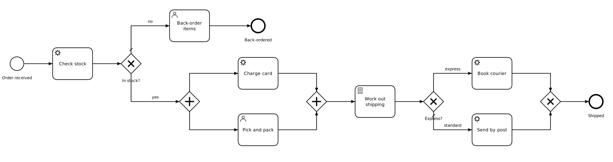

- A start form, `order.xhtml`: repeated lines of an item, a quantity and a
  price, added and removed in the form, with each line's amount and the
  total worked out as they are typed. Its handler checks the order again,
  works the total out itself, sets `lines`, and makes the order number the
  business key.
- Exclusive gateways splitting by FEEL conditions (`inStock`,
  `express = true`), with default flows, and one merging.
- A parallel split and join: the card is charged while the order is
  packed.
- User tasks for a candidate group, with a priority computed from the
  order (`=if express then 80 else 50`).
- Service tasks on topics, and a script task (`wf:action`).
- Execution listeners on the process's start and end, one with a field.
- A task listener on create with fields, one of them an expression
  (`=if express then "PT2H" else "P1D"`).
- Input parameters written as a `camunda:list` and a `camunda:map`, and an
  output parameter that builds a FEEL context from them
  (`={customer: packing.customer, items: packing.items, tape: checklist[3]}`).
- A delegate called by name (`${mailer}`) with text and expression fields.

## Loan application

`loan-application/` — scored by a decision table (`risk.dmn`).

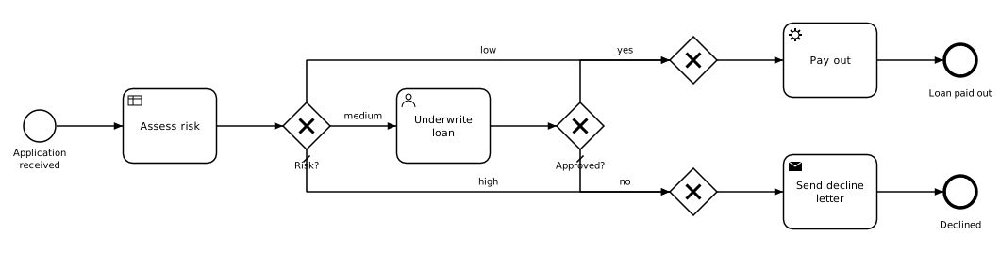

- Three decisions in one file: `applicant-score`, a `COLLECT SUM` table
  whose inputs are FEEL expressions --
  `years and months duration(date(employedSince), today()).years`,
  `debts / income` -- with ranges like `[2..5)`; `loan-risk`, which
  requires it (`informationRequirement`) and reads its score; and
  `loan-limit`, a literal expression.
- Two business rule tasks, each result mapped to one value (`singleEntry`),
  and a condition using both (`risk = "low" and amount <= maxLoan`).
- Conditions in FEEL and in Camunda 7's `${...}`, side by side.
- A start form generated from its fields (`camunda:formData`), with
  `applicationId` as the business key.
- An underwriter's task with a due date two days ahead
  (`=now() + duration("P2D")`) and a form, `underwrite.xhtml`, over its
  fields: the applicant and the loan in groups, the loan's share of income
  worked out, the amount compared with the limit, and a reason that is
  required only to decline.
- Candidate starters on the process (`branch-staff`).
- A task listener routing large loans to a senior underwriter
  (`=if amount > 50000 then "senior-underwriter" else null`), and a
  `camunda:map` summary for the underwriter.
- An end listener with an expression field, and a send task that is a
  delegate with fields.

## Travel booking

`travel-booking/` — book, and undo the bookings when payment fails.

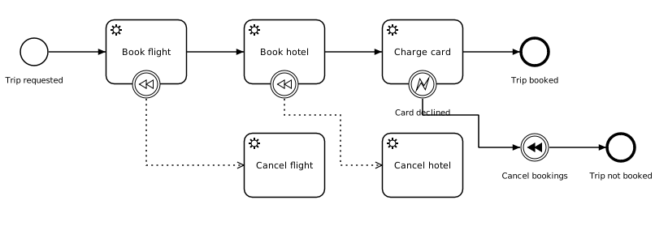

- Compensation: a boundary event on each booking, associated with its
  handler (`isForCompensation`), and an intermediate compensation throw
  that runs them, newest first.
- An error boundary catching the BPMN error `card-declined` that a worker
  answers with.

## Customer onboarding

`customer-onboarding/` — wait for documents, then check what the customer
needs.

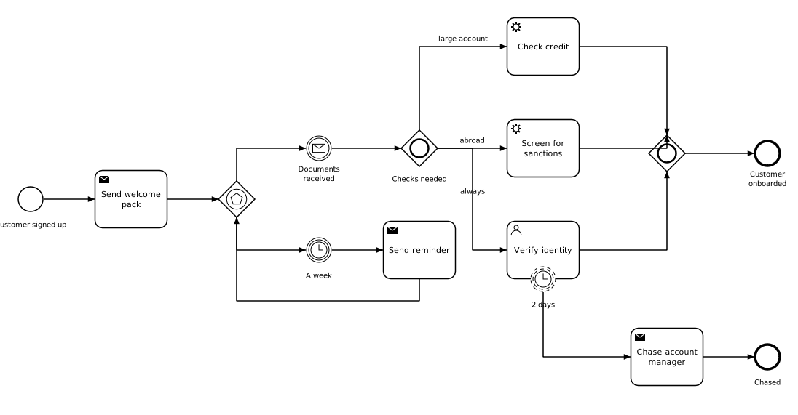

- An event-based gateway between a message (`documents-received`) and a
  timer (`P7D`), in a loop: the customer is reminded every week.
- An inclusive split and join: only the checks whose conditions hold run
  (`expectedVolume > 100000`, `not(country in ["DE", "FR", "NL"])`).
- A non-interrupting timer boundary (`P2D`) that chases someone while the
  task goes on.

## Expense review

`expense-review/` — several reviewers, two approvals enough.

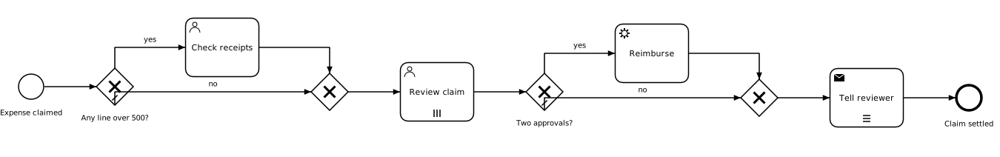

- A condition over a list of contexts:
  `some line in lines satisfies line.amount > 500`.
- A parallel multi-instance user task over a collection (`reviewers`),
  each instance assigned to its element variable (`${reviewer}`), with
  inputs computed from the lines (`=sum(lines.amount)`,
  `=max(lines.amount)`).
- A review form, `review.xhtml`, listing the claim's lines, with a note on
  those over 500 that finance checked: a reviewer approves or rejects, and
  a rejection needs a reason, which the handler adds to `notes`.
- Output mappings counting approvals and carrying the notes out, and a
  completion condition (`approvals >= 2`) that withdraws the reviews still
  open.
- A sequential multi-instance send task, a delegate whose fields read
  each instance's element variable.

## Support ticket

`support-ticket/` — resolve within eight hours.

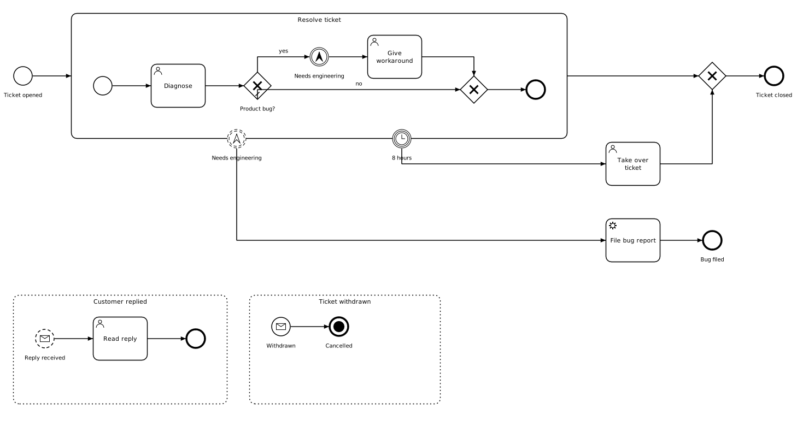

- An embedded subprocess with an interrupting timer boundary (`PT8H`).
- An escalation thrown inside it and caught, without interrupting, on its
  boundary.
- A task listener whose due date depends on the ticket
  (`=if priority = "urgent" then "PT1H" else "PT4H"`), and start and end
  listeners on the subprocess.
- Event subprocesses: a non-interrupting message start
  (`customer-replied`), and an interrupting one (`ticket-withdrawn`) that
  ends everything with a terminate end event.

## Shipping

`shipping/` — two processes, one calling the other.

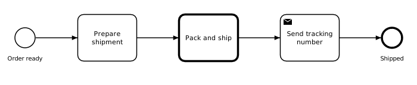

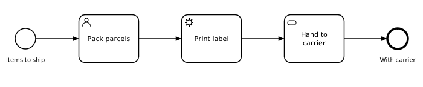

- A call activity passing variables in and out (`camunda:in`,
  `camunda:out`) and the business key.
- Input and output parameters on a task (`=count(items)`).
- An asynchronous continuation (`camunda:asyncBefore`) with a retry cycle
  (`R3/PT5M`), and a manual task.

## Inventory

`inventory/` — three processes.

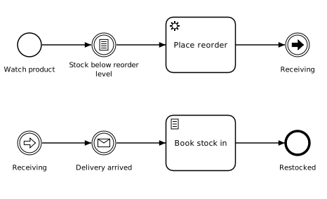

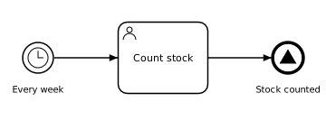 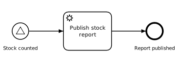

- A conditional catch event that waits until `stock < reorderLevel`,
  looking again when `stock` changes.
- Link events carrying the flow from one half of the diagram to the
  other.
- A timer start event with a cycle (`R/P7D`), a signal end event, and a
  signal start event in another process that the signal starts.
